# Diagrama Entidade-Relacionamento (ERD) — Vértice Database

Este documento descreve a modelagem relacional completa do banco de dados do **Vértice App** (PostgreSQL 16).

---

## 1. Diagrama de Relacionamentos (Mermaid)

```mermaid
erDiagram
    USUARIOS ||--o| ENDERECOS : "possui (1:1/1:N)"
    USUARIOS ||--o| CARTEIRA_SALDO : "possui (1:1)"
    USUARIOS ||--o| PROTOCOLO_VIOLETA : "possui (1:1)"
    USUARIOS ||--o{ CARTOES_PAGAMENTO : "cadastra (1:N)"
    USUARIOS ||--o{ ASSINATURAS : "possui (1:N)"
    PLANOS ||--o{ ASSINATURAS : "define (1:N)"
    USUARIOS ||--o{ TRANSACOES_FINANCEIRAS : "movimenta (1:N)"
    USUARIOS ||--o{ PROPOSTAS_SERVICOS : "solicita (1:N)"
    USUARIOS ||--o| FREELANCERS : "vinculado_a (1:1)"
    
    FREELANCERS ||--o{ AVALIACOES : "recebe (1:N)"
    USUARIOS ||--o{ AVALIACOES : "escreve (1:N)"
    FREELANCERS ||--o{ PROPOSTAS_SERVICOS : "recebe (1:N)"
    FREELANCERS ||--o{ OFERTAS_SERVICOS : "publica (1:N)"
    
    TRILHA_MODULOS ||--|{ TRILHA_LICOES : "contem (1:N)"
    TRILHA_LICOES ||--|{ TRILHA_CARDS : "contem (1:N)"
    USUARIOS ||--o{ TRILHA_PROGRESSO_USUARIO : "conclui (1:N)"
    TRILHA_LICOES ||--o{ TRILHA_PROGRESSO_USUARIO : "registrada_em (1:N)"

    USUARIOS {
        varchar id PK "Ex: usr_ana"
        varchar firebase_uid UK "Auth externa / Firebase"
        varchar name "Nome completo"
        varchar email UK "Email de login"
        varchar phone "Telefone verificado"
        varchar cpf UK "CPF único"
        date birth_date "Data de nascimento"
        varchar password_hash "Bcrypt hash"
        text bio "Apresentação"
        text skills "Array de competências"
        text avatar_url "URL da foto"
        boolean is_pro "Status Vértice Pro"
        boolean violeta_verified "Selo Violeta"
        int profile_completion "0 a 100%"
        numeric rating "Nota média (0.0 a 5.0)"
        int completed_services "Total de atendimentos"
        boolean notifications_enabled "Push ligadas"
        timestamptz created_at
        timestamptz updated_at
    }

    ENDERECOS {
        uuid id PK
        varchar usuario_id FK "usuarios.id (CASCADE)"
        varchar cep
        varchar rua
        varchar numero
        varchar complemento
        varchar district "Bairro"
        varchar cidade
        varchar estado "UF (2 letras)"
        numeric latitude
        numeric longitude
        timestamptz created_at
        timestamptz updated_at
    }

    FREELANCERS {
        varchar id PK "Ex: flw_camila, flw_ana"
        varchar usuario_id FK "usuarios.id (SET NULL)"
        varchar name "Nome profissional"
        varchar role "Função / Título"
        varchar area "Área de atuação"
        varchar category "CONSTRUCTION, BEAUTY, etc."
        int match_percent "Compatibilidade"
        numeric rating "Nota de avaliação"
        int services_count "Contagem de serviços"
        varchar availability "Disponibilidade"
        text bio "Descrição"
        varchar gender "FEMALE, MALE, OTHER"
        text avatar_url
        int hours_worked "Total de horas"
        int jobs_done "Trabalhos entregues"
        boolean is_violeta "Participa do Violeta"
        boolean is_pro "Selo Pro ativo"
        text skills "Array de tags"
        numeric hourly_rate "Taxa por hora (R$)"
        int distance_km "Distância aproximada"
        numeric latitude
        numeric longitude
        timestamptz created_at
        timestamptz updated_at
    }

    AVALIACOES {
        uuid id PK
        varchar freelancer_id FK "freelancers.id (CASCADE)"
        varchar autor_id FK "usuarios.id (SET NULL)"
        varchar autor_nome
        numeric nota "1.0 a 5.0"
        text comentario
        timestamptz created_at
    }

    PROPOSTAS_SERVICOS {
        uuid id PK
        varchar cliente_id FK "usuarios.id (CASCADE)"
        varchar freelancer_id FK "freelancers.id (CASCADE)"
        varchar service_type "Tipo do serviço"
        numeric budget "Orçamento proposto"
        date data_agendamento
        time hora_agendamento
        text localizacao
        text descricao
        text photo_urls "Array de fotos"
        varchar urgencia "NORMAL, ALTA, URGENTE"
        varchar status "PENDENTE, ACEITO, etc."
        timestamptz created_at
        timestamptz updated_at
    }

    OFERTAS_SERVICOS {
        uuid id PK
        varchar freelancer_id FK "freelancers.id (CASCADE)"
        varchar category
        varchar title
        text description
        numeric price
        varchar city
        varchar availability
        timestamptz created_at
    }

    CARTEIRA_SALDO {
        uuid id PK
        varchar usuario_id FK "usuarios.id (CASCADE, UNIQUE)"
        numeric disponivel "Saldo sacável (R$)"
        numeric pendente "Saldo retido (R$)"
        varchar moeda "BRL"
        timestamptz updated_at
    }

    TRANSACOES_FINANCEIRAS {
        varchar id PK
        varchar usuario_id FK "usuarios.id (CASCADE)"
        varchar client_name
        varchar service
        varchar location
        numeric amount "Valor (R$)"
        date data_transacao
        varchar status "LIBERADO, PENDENTE, etc."
        timestamptz withdrawable_at "Data/hora de liberação"
        timestamptz created_at
    }

    CARTOES_PAGAMENTO {
        varchar id PK
        varchar usuario_id FK "usuarios.id (CASCADE)"
        varchar brand "Bandeira (Visa, etc.)"
        varchar last4 "Últimos 4 dígitos"
        varchar holder_name "Nome no cartão"
        varchar expiry "MM/AA"
        varchar label "Apelido do cartão"
        boolean is_primary
        timestamptz created_at
    }

    PLANOS {
        varchar id PK "plan_pro_monthly"
        varchar name "Vértice Pro"
        numeric monthly_price "19.99"
        text benefits "Array de benefícios"
        boolean active
        timestamptz created_at
    }

    ASSINATURAS {
        uuid id PK
        varchar usuario_id FK "usuarios.id (CASCADE)"
        varchar plano_id FK "planos.id"
        boolean active
        date next_charge_date
        boolean auto_renew
        varchar auto_renew_method "PIX, CARD"
        varchar status "UP_TO_DATE, OVERDUE, etc."
        timestamptz created_at
        timestamptz updated_at
    }

    PROTOCOLO_VIOLETA {
        uuid id PK
        varchar usuario_id FK "usuarios.id (CASCADE, UNIQUE)"
        boolean enabled "Habilitado pelo usuário"
        boolean identity_verified "Doc validado"
        boolean phone_verified "SMS validado"
        timestamptz identity_verified_at
        timestamptz phone_verified_at
        boolean safe_route_enabled "Compartilhar trajeto"
        boolean emergency_button_enabled "Botão de socorro"
        text documento_frente_url
        text documento_verso_url
        text selfie_url
        timestamptz updated_at
    }

    TRILHA_MODULOS {
        varchar id PK "m1 a m5"
        varchar title "Ex: Segurança Pessoal"
        int ordem
        timestamptz created_at
    }

    TRILHA_LICOES {
        varchar id PK "s1 a f3"
        varchar modulo_id FK "trilha_modulos.id (CASCADE)"
        varchar title "Ex: Proteção digital"
        int ordem
        timestamptz created_at
    }

    TRILHA_CARDS {
        uuid id PK
        varchar licao_id FK "trilha_licoes.id (CASCADE)"
        varchar heading "Título do cartão"
        text body "Conteúdo educativo"
        text tip "Dica prática de segurança"
        int ordem
    }

    TRILHA_PROGRESSO_USUARIO {
        varchar usuario_id PK,FK "usuarios.id (CASCADE)"
        varchar licao_id PK,FK "trilha_licoes.id (CASCADE)"
        boolean done "Lição concluída"
        timestamptz completed_at
    }
```

---

## 2. Grupos de Agregados

1. **Núcleo de Usuários & Segurança:** `usuarios`, `enderecos`, `protocolo_violeta`.
2. **Marketplace & Match:** `freelancers`, `avaliacoes`, `propostas_servicos`, `ofertas_servicos`.
3. **Financeiro & Monetização:** `carteira_saldo`, `transacoes_financeiras`, `cartoes_pagamento`, `planos`, `assinaturas`.
4. **Educação & Trilha de Blindagem:** `trilha_modulos`, `trilha_licoes`, `trilha_cards`, `trilha_progresso_usuario`.
